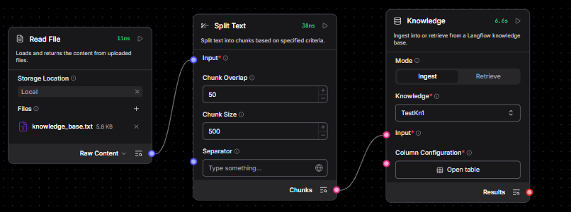
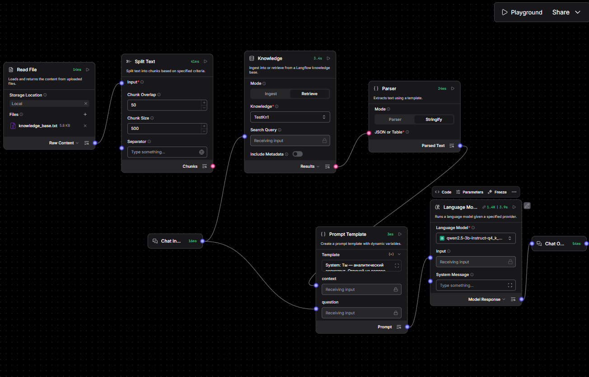
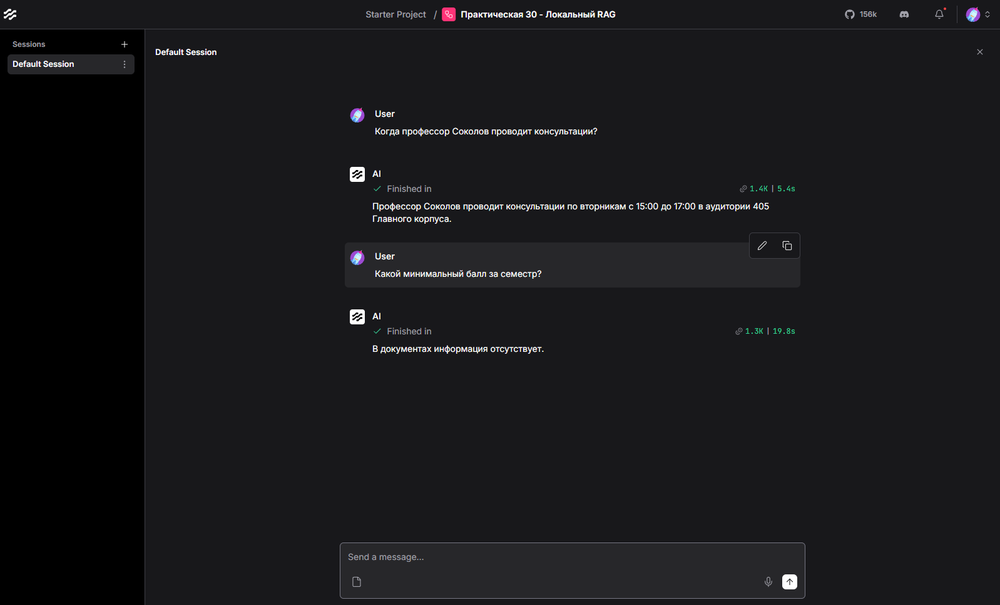

# Практическая работа №30: Построение локальной RAG-системы (Retrieval-Augmented Generation) в Langflow. 2 часа

---

## 🎯 Цель работы
Изучение архитектуры систем дополненной генерации (RAG), освоение методов загрузки, сегментации (chunking) и векторизации текстовых документов, построение векторного индекса и реализация семантического поиска контекста для предотвращения галлюцинаций LLM при ответах на вопросы по узкоспециализированным документам.

---

## 📌 Задачи
1. Подготовить текстовый файл-источник знаний (`knowledge_base.txt`).
2. Построить конвейер индексации: загрузка файла, разбиение на чанки, генерация эмбеддингов, сохранение в векторное хранилище.
3. Построить конвейер поиска и генерации: приём вопроса, извлечение k релевантных чанков, подстановка контекста в промпт LLM.
4. Провести эксперимент по сравнению ответов модели с RAG-контекстом и без него; проверить поведение при отсутствии ответа в базе знаний.

---

## 📁 Материалы и методы
- **Langflow** (`http://<IP_лаборатории>:7860`), локальная LLM (`http://<IP_LLM>:8080/v1`, модель `qwen2.5-3b-instruct-q4_k_m.gguf`).
- Сервер эмбеддингов **istp-embeddings** (OpenAI-совместимый API): Base URL `http://istp-embeddings:8021/v1` (имя сервиса Docker-сети — из Langflow оно доступно без IP), модель `paraphrase-multilingual-MiniLM-L12-v2` (мультиязычная, CPU).
- Файл знаний: `/app/data/knowledge_base.txt` (регламент кафедры) — доступен в Langflow как локальный файл.

---

## 📚 Краткая теоретическая информация

### RAG: архитектура
RAG (Retrieval-Augmented Generation) дополняет генерацию модели внешними знаниями: документ разбивается на **чанки**, каждый чанк преобразуется моделью эмбеддингов в **вектор** и сохраняется в **векторном хранилище**. При запросе вопрос векторизуется, поиск по сходству (косинусное расстояние) извлекает top-k чанков, которые подставляются в промпт как контекст. Модель отвечает строго по контексту — это снижает галлюцинации и позволяет обновлять базу знаний без переобучения модели.

### Chunking
Разбиение на чанки выполняется сплиттером (Recursive Character Text Splitter): `Chunk Size` — размер фрагмента в символах, `Chunk Overlap` — перекрытие соседних чанков для сохранения целостности смысла на границах.

---

## 🛠️ Порядок выполнения работы

### Шаг 1. Подготовка документа знаний
Файл `knowledge_base.txt` (регламент кафедры: правила лабработ, график консультаций, критерии оценивания) размещён в [каталоге данных Langflow `/app/data`](../langflow/data).

### Шаг 2. Конвейер индексации
1. Создайте flow `Практическая 30 - Локальный RAG` и добавьте компоненты:
- **Files & Knowledge → Read File**: Select files; добавьте файл `knowledge_base.txt`;
- **Processing → Split Text**: `Chunk Size = 500`, `Chunk Overlap = 50`;
- **Files & Knowledge → Knowledge**.

2. Соедините: Read File → Split Text → Knowledge Base, как показано на рисунке



3. В блоке `Knowledge` есть пункт `Knowledge`, в окне его выбора указано `Select an option`. Нажмите на него и выберите `+ Create new Knowledge Base`

- Заполните `Knowledge Name*`, например, `TestKn`
- В поле `Choose Embedding Model*` нажмите `Manage Model Providers`, выберите `OpenAI Compatible`, в поле `Base URL*` укажите `http://istp-embeddings:8021/v1`, в поле `API Key` укажите любой текст (например, `api-key`), нажмите `Save`. В списке моделей появится `sentence-transformers/paraphrase-multilingual-MiniLM-L12-v2`. Закройте это окно
- В поле `Choose Embedding Model*` выберите `sentence-transformers/paraphrase-multilingual-MiniLM-L12-v2`
- В поле `DB Provider*` выберите `Chroma Local` (название уже отображается, но нужно открыть список и выбрать повторно)
- Нажмите Create

4. На блоке `Knowledge` сверху справа есть треугольник (кнопка а-ля `Play`). Нужно ее нажать - база Chroma заполнится данными из файла.

5. Нажмите сверху на слова `Starter Project` и слева внизу выберите `Knowledge`. В списке должна быть созданная база ненулевого размера.

* При попытке создания базы повторно (если что-то не получилось) нужно менять названия базы для исключения ошибок.

Обратный переход в проект `Starter Project` → `Практическая 30 - Локальный RAG`

### Шаг 3. Конвейер поиска и генерации

1. В блоке **Knowledge** в разделе `Mode` переведите переключатель на `Retrieve`. Связь с `Split Text` при этом разорвется.
2. Добавьте **Chat Input**, **Parser**, **Prompt Template**, **Language Model** (`qwen2.5-3b-...`), **Chat Output**.
3. В блоке **Parser** переведите `Mode` в `Stringify`.
4. В блоке **Language Model** выберите модель `qwen2.5-3b...`
5. В `Template` **Prompt Template** введите

```text
System: Ты — аналитический ассистент. Отвечай на вопрос ПОЛЬЗОВАТЕЛЯ строго на основе предоставленного КОНТЕКСТА. Если в контексте нет ответа, скажи: «В документах информация отсутствует».

КОНТЕКСТ:
{context}

ВОПРОС ПОЛЬЗОВАТЕЛЯ:
{question}
```

Соедините: 
- Chat Input → `question` (Prompt Template) и `Search Query` (Knowledge);
- `Results` (Knowledge) → `JSON or Table` (Parser);
- `Parsed Text` (Parser) → `context` (Prompt Template);
- `Prompt` (Prompt Template) → `Input` (Language Model)
- `Model Response` (Language Model) → Chat Output.



### Шаг 4. Тестирование
1. В **Playground** задайте точечные вопросы по файлу (например, «Когда профессор Соколов проводит консультации?»).
2. Задайте вопрос, ответ на который в файле отсутствует, и зафиксируйте поведение модели.


---

## 📝 Отчёт
1. Включите: описание конвейера (обе ветви — индексация и генерация), параметры компонентов, скриншоты Playground с извлечёнными чанками, результаты тестов (включая вопрос без ответа в базе).
2. **Экспортируйте flow** (кнопка **Export**) в JSON.
3. Подготовьте ответы на контрольные вопросы.
4. Сохраните: `reports/Pr_30/Pr_30_report.md` и `reports/Pr_30/Pr_30_rag.json` (имя JSON — по вашему выбору, но с префиксом `Pr_30_`).
5. Отправьте:

```bash
git add . && git commit -m "Pr_30 report" && git push
```

> 📖 Используйте [справочник по Markdown](./MD_Instructions.md) для оформления.

---

> ⏳ Оценка запустится автоматически в GitLab CI: техническая часть проверяется по экспорту flow, ответы на контрольные вопросы — языковой моделью. Результат появится в разделе **CI/CD → Pipelines**.

---

## Контрольные вопросы
1. В чем заключается ключевое отличие архитектуры RAG от дообучения (Fine-Tuning) языковой модели?
2. Почему при разбиении документа на чанки критически важно использовать параметр перекрытия (`Chunk Overlap`)?
3. Что такое векторный эмбеддинг и какая математическая мера используется для поиска релевантных чанков в векторном пространстве?
4. Какие проблемы возникают при слишком маленьком (`Chunk Size = 50`) и слишком большом (`Chunk Size = 4000`) размере чанка?
5. Каким образом системный промпт предотвращает галлюцинации модели при отсутствии нужного ответа в базе знаний?
