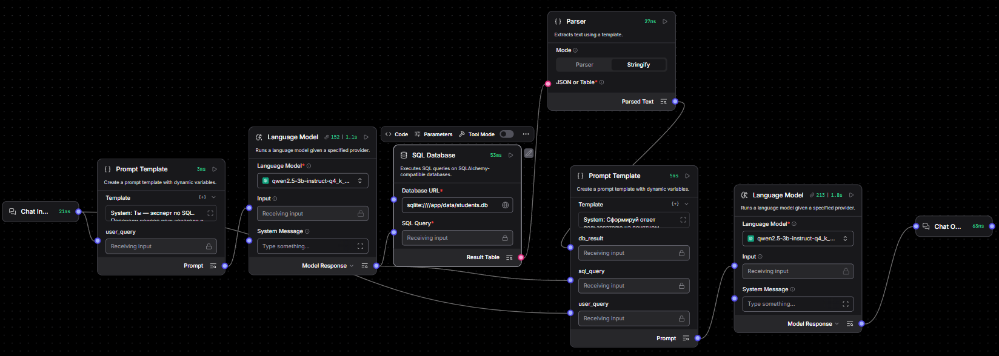

# Практическая работа №31: Разработка интеллектуальной системы доступа к SQL-базам данных (NLPtoSQLtoNLP) в Langflow. 2 часа

---

## 🎯 Цель работы
Изучение архитектуры интеллектуальных агентов и цепочек трансляции естественного языка в структурированные запросы к базам данных (Text-to-SQL / NLPtoSQLtoNLP). Освоение методов автоматической генерации синтаксически корректных SQL-запросов на основе DDL-схемы реляционной БД, их выполнения в СУБД SQLite и последующей интерпретации результатов языковой моделью.

---

## 📌 Задачи
1. Подготовить базу данных SQLite `students.db` с учебными таблицами (`students`, `courses`, `grades`).
2. Разместить компоненты работы с реляционными БД в Langflow.
3. Построить первый этап трансляции (NLP → SQL): передача DDL-схемы и вопроса пользователя в LLM для построения SQL-запроса.
4. Настроить компонент выполнения SQL-запросов в локальной СУБД SQLite.
5. Построить второй этап (SQL Result → NLP): передача табличного результата обратно в LLM для формирования естественного ответа.
6. Провести тесты со сложными запросами (`JOIN`, `GROUP BY`, `AVG`, `COUNT`).

---

## 📁 Материалы и методы
- **Langflow** (`http://<IP_лаборатории>:7860`), локальная LLM (`http://<IP_LLM>:8080/v1`).
- База данных: `/app/data/students.db` (SQLite) — доступна Langflow как локальный файл. Структура:

```sql
CREATE TABLE students (student_id INTEGER PRIMARY KEY, full_name TEXT NOT NULL, group_num TEXT NOT NULL);
CREATE TABLE courses  (course_id INTEGER PRIMARY KEY, course_name TEXT NOT NULL);
CREATE TABLE grades   (student_id INTEGER, course_id INTEGER, grade INTEGER CHECK (grade BETWEEN 2 AND 5),
                       PRIMARY KEY (student_id, course_id));
```

---

## 📚 Краткая теоретическая информация

### NLPtoSQLtoNLP: двухэтапная трансляция
Модель не имеет прямого доступа к данным БД. Цепочка решает эту проблему разделением ролей:
1. **NLP → SQL**: LLM получает DDL-схему (имена таблиц/столбцов, типы) и вопрос пользователя, генерирует чистый SQL-запрос;
2. **выполнение**: СУБД SQLite выполняет запрос и возвращает табличный результат (реальные данные);
3. **SQL → NLP**: вторая LLM интерпретирует табличный результат и формулирует ответ на естественном языке.

### Компонент SQL Database в Langflow
Компонент принимает `Database URL` (для SQLite: `sqlite:////<путь к файлу>`) и `query`. Параметр `add_error` передаёт сообщения об ошибках СУБД дальше по цепочке — это основа обработки некорректных запросов.

---

## 🛠️ Порядок выполнения работы

### Шаг 1. Проверка базы данных
Файл `students.db` размещён в `/app/data` (скрипт генерации — `create_students_db.py`).

### Шаг 2. Размещение компонентов
Создайте flow `Практическая 31 - NLPtoSQLtoNLP`. Добавьте: **Chat Input**, **Chat Output**, два компонента **Prompt Template** (Prompt Template 1, Prompt Template 2), два компонента **Language Model**, компонент **Parser**, компонент **SQL Database**.

### Шаг 3. Первый этап (NLP → SQL)

1. Заполните шаблон **Prompt Template 1**:

```text
System: Ты — эксперт по SQL. Переведи вопрос пользователя в корректный SQL-запрос для SQLite. Выдавай ТОЛЬКО чистый SQL без кавычек и markdown.

СХЕМА БД:
students(student_id, full_name, group_num)
courses(course_id, course_name)
grades(student_id, course_id, grade)

ВОПРОС: {user_query}
SQL:
```

2. Соедините **Chat Input** → `user_query` (**Prompt Template 1**).
3. **Language Model 1** - выберите `qwen2.5-3b...`.
4. Соедините выход `Prompt` (**Prompt Template 1**) → `Input` (**Language Model 1**)
5. Соедините `Model Response` (**Language Model 1**) → `SQL Query` (**SQL Database**)

### Шаг 4. Выполнение SQL и второй этап (SQL → NLP)
1. В блоке **SQL Database** заполните `Database URL` текстом `sqlite:////app/data/students.db`, через `Parameters` включите `add_error`.
2. Соедините `Result Table` (**SQL Database**) → `JSON or Table` (**Parser**).
3. Переключите `Mode` (**Parser**) в `Stringify`
4. Заполните **Prompt Template 2** шаблоном:

```text
System: Сформируй ответ пользователю на понятном русском языке на основе результатов из базы данных.

ВОПРОС: {user_query}
SQL ЗАПРОС: {sql_query}
РЕЗУЛЬТАТ БД: {db_result}
ОТВЕТ:
```

5. Соедините `Parsed Text` (**Parser**) → `db_result` (**Prompt Template 2**).
6. Соедините Chat Input → `user_query` (**Prompt Template 2**) и `Model Response` (**Language Model 1**) → `sql_query` (**Prompt Template 2**)
7. Соедините `Prompt` (**Prompt Template 2**) → `Input` (**Language Model 2**)
8. Соедините `Model Response` (**Language Model 2**) → Chat Output.



### Шаг 5. Тестирование в Playground
Тестовые вопросы:
- «Выведи список студентов группы ИВТ-401»;
- «Какая средняя оценка у Иванова Ивана?» (JOIN + AVG);
- «Сколько оценок по каждому курсу?» (GROUP BY + COUNT).

Для каждого запроса зафиксируйте сгенерированный SQL и ответ системы.

---

## 📝 Отчёт
1. Включите: структуру БД, описание компонентов и цепочки, таблицу тестов (вопрос → SQL → результат → ответ), выводы о корректности генерации сложных запросов.
2. **Экспортируйте flow** (кнопка **Export**) в JSON.
3. Подготовьте ответы на контрольные вопросы.
4. Сохраните: `reports/Pr_31/Pr_31_report.md` и `reports/Pr_31/Pr_31_nlpsql.json` (имя JSON — по вашему выбору, но с префиксом `Pr_31_`).
5. Отправьте:

```bash
git add . && git commit -m "Pr_31 report" && git push
```

> 📖 Используйте [справочник по Markdown](./MD_Instructions.md) для оформления.

---

> ⏳ Оценка запустится автоматически в GitLab CI: техническая часть проверяется по экспорту flow, ответы на контрольные вопросы — языковой моделью. Результат появится в разделе **CI/CD → Pipelines**.

---

## Контрольные вопросы
1. В чем заключаются уязвимости безопасности (SQL-инъекции) при автоматической генерации SQL-кода моделью LLM?
2. Почему для правильного формирования SQL-запроса языковой модели необходима точная DDL-схема таблиц?
3. Каким образом двухэтапная схема (NLP -> SQL -> СУБД -> NLP) компенсирует отсутствие у LLM прямого доступа к содержимому базы данных?
4. Какие промпт-инструкции исключают добавление лишней Markdown-разметки при выходе модели?
5. Как обработать синтаксическую ошибку SQL-запроса, переданного на выполнение в СУБД?
